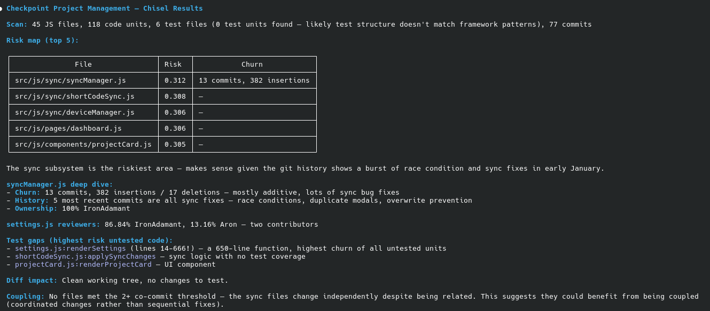

# Chisel

Test impact analysis and code intelligence for AI coding agents. One std-only Rust binary, no crates, MIT licensed.

After an edit, an agent asks Chisel **which tests to run**, **which files are risky**, and **who knows this code**. Chisel answers from a graph of your code, your tests, and your git history, over MCP (Claude Code, Cursor, Windsurf, Cline) or a JSON CLI.



## Install

Download a binary for Linux (musl), macOS (arm64, x64), or Windows from [Releases](https://github.com/IronAdamant/Chisel/releases), put it on your `PATH` as `chisel`, and make sure `git` is installed. Or build it:

```bash
git clone https://github.com/IronAdamant/Chisel.git
cd Chisel
cargo build --release        # binary: target/release/chisel
```

On Windows without the MSVC Build Tools, build with the GNU toolchain: `cargo +stable-x86_64-pc-windows-gnu build --release`, adding `RUSTFLAGS="-C link-self-contained=yes"` if your MinGW is llvm-mingw.

## Use with Claude Code (MCP)

Add to `.mcp.json` in your project (or `~/.claude.json`):

```json
{
  "mcpServers": {
    "chisel": {
      "command": "chisel",
      "args": ["serve-mcp"],
      "env": { "CHISEL_PROJECT_DIR": "/path/to/your/project" }
    }
  }
}
```

The snapshot goes to `<project>/.chisel/store` unless `CHISEL_STORAGE_DIR` says otherwise. Any stdio MCP client works the same way. `chisel serve --port 8377` is a separate JSON HTTP API (`GET /health`, `GET /tools`, `POST /call`), not an MCP URL.

The agent loop: call `analyze` once, `diff_impact` after each edit, run the tests it names, then `record_result`. When something needs doing, the response has a `status` (`no_data`: call `analyze`; `stale_db`: call `update`), and most responses suggest `next_steps`. The full calling contract is in [AGENTS.md](AGENTS.md). A ready-made Claude Code skill is in [skills/SKILL.md](skills/SKILL.md).

## CLI in 30 seconds

```bash
chisel analyze .                           # build the graph (once; `update` after that)
chisel diff-impact --json                  # tests touched by your uncommitted changes
chisel suggest-tests src/engine/analyze.rs # ranked tests for one file
chisel triage                              # top risky files, untested code, stale tests
chisel run -- pytest tests/                # run tests and record pass/fail
```

`chisel --help` lists every command and `chisel <command> --help` shows its flags. With `--json`, branch on `status`: `error` and `git_error` exit 1, everything else exits 0.

## MCP tools

| Tool | Answers |
|---|---|
| `analyze`, `update` | Build or incrementally refresh the snapshot. `start_job`, `job_status`, `cancel_job` run them in the background. |
| `diff_impact` | Which tests cover what changed in `git diff` (plus untracked code)? |
| `impact`, `suggest_tests` | Which tests cover these files, ranked? |
| `triage`, `risk_map`, `test_gaps` | Where is risk: churn, coupling, coverage gaps, one-author code, flaky tests? |
| `churn`, `coupling`, `history` | How often does this change, and what changes with it? |
| `ownership`, `who_reviews` | Who wrote it, and who maintains it now? |
| `stale_tests` | Which tests point at code that no longer exists? |
| `record_result`, `stats`, `optimize_storage` | Feed results back, read counts, compact the snapshot. |
| `issues`, `issue`, `trace` | Which tests are failing, what probably broke them, and what fixed them before. |
| `acquire_file_lock` and five more lock tools | Advisory locks with a `purpose` note so parallel agents see who is editing what. |

## Tool groups

Every MCP tool belongs to one group. When Chisel runs next to other tools that already cover a feature, switch that group off so its schemas stop taking context. `CHISEL_TOOLS` lists what to keep (groups or tool names, `all` allowed); `CHISEL_DISABLE` lists what to hide and is applied after it. `core` is always on. Empty values count as unset; with neither set, nothing changes. The CLI is not affected.

| Group | Tools | Overlaps with |
|---|---|---|
| `core` (always on) | `analyze`, `update`, `diff_impact`, `impact`, `suggest_tests`, `record_result`, `stats` | none |
| `risk` | `risk_map`, `test_gaps`, `triage`, `stale_tests` | none |
| `history` | `churn`, `ownership`, `coupling`, `history`, `who_reviews` | other suite tools' git history lookups |
| `maintenance` | `start_job`, `job_status`, `cancel_job`, `optimize_storage` | none |
| `locks` | `acquire_file_lock`, `release_file_lock`, `refresh_file_lock`, `check_file_lock`, `check_locks`, `list_file_locks` | Trammel step claims, CoordinationHub leases |
| `issues` | `issues`, `issue`, `trace` | none |

```json
"env": {"CHISEL_DISABLE": "locks,history"}
```

An unknown name, or `core` (or a core tool) in `CHISEL_DISABLE`, stops the server with exit code 2 and a one-line message listing the valid groups and tools. Calling a hidden tool returns an error that says which variable to change.

### Choosing groups (for agents)

Write the choice into the project's root `AGENTS.md`; Chisel re-reads it on each request and tells the client when its tool list changes:

````markdown
```agent-tools
chisel: disable locks, history
```
````

Turn off `locks` when one agent works on the project or CoordinationHub/Trammel manages claims, `history` when you read git history yourself, `risk` when you only need which tests to run, `maintenance` when `analyze` is quick, and `issues` when no test-capture hook runs in the project. Bad names become warnings in the `initialize` instructions, never errors. Env vars override the file key by key. See [AGENTS.md](AGENTS.md#choosing-groups).

## Issues and traceability

Chisel logs test failures as issues with no model tokens spent. A Claude Code `PostToolUse` hook pipes every test run the agent makes (cargo test, pytest, Jest, Vitest, go test, node:test) into `chisel capture`, which parses failing tests, records each result, and keeps one issue per distinct failure:

- **Dedupe:** test id plus the error with numbers, paths, addresses and times stripped. Repeats raise a count.
- **Suspects:** the code the failing test covers (its test edges) that changed since the test last passed, ranked by the size of the change, uncommitted edits, recency and churn, each with a one-line reason.
- **Auto-close:** when the test passes again the issue closes with the fixing commit (or `uncommitted`) and the files changed since it failed. The same failure later reopens it.

The hook prints nothing on success and one line for a new, reopened or fixed issue; it always exits 0 and does nothing in a project without a snapshot (run `chisel analyze` once). `chisel hook-install` prints the hooks and `chisel hook-install --write` merges them into `.claude/settings.local.json`:

```json
{"hooks": {
  "PostToolUse": [{"matcher": "Bash", "hooks": [{"type": "command", "command": "chisel capture --hook"}]}],
  "SessionStart": [{"hooks": [{"type": "command", "command": "chisel issues --brief"}]}]
}}
```

The SessionStart line prints at most two lines, and only when issues are open. Agents read issues through the `issues` group: `issues` (compact rows, about 150 bytes each), `issue` (suspects, occurrences, excerpt, fix) and `trace` (what broke in a file or function and what fixed it). Without hooks, `chisel run -- <test command>` runs the tests and captures them the same way.

## How it works

1. **Scan.** `git ls-files` lists code. A built-in extractor (no tree-sitter) finds functions, classes, and tests in Python, JS/TS, Go, Rust, Java, Kotlin, C#, C/C++, Swift, PHP, Ruby, and Dart, and recognises pytest, Jest, Playwright, Go test, Rust `#[test]`, JUnit, xUnit, XCTest, PHPUnit, RSpec, gtest, and Dart test.
2. **Link.** Each test's imports and calls become edges to the code units they reach; in a Cargo workspace only units in crates the test's crate depends on. Imports between code files form a second graph that `diff_impact` walks for indirect hits, and it follows callers of the changed functions one or two calls up (`depth`, default 2).
3. **Mine git.** One `git log --numstat` and one `git log -p` stream give churn, co-change coupling, per-function history and authorship. Chisel replays git's own `-L` and blame rules over the stream instead of starting git once per function and per file.
4. **Store.** Everything lands in one JSON snapshot, `.chisel/store`, written atomically under a cross-process lock. `update` re-reads only changed files and new commits.
5. **Answer.** Queries read the snapshot, so most calls return in milliseconds; `diff_impact` also asks git what changed.

Scores are heuristics. Read `_meta.uniform_components` before trusting a composite risk score.

## More

- [AGENTS.md](AGENTS.md): statuses, environment variables, sharding, scale limits
- [docs/AGENT_PLAYBOOK.md](docs/AGENT_PLAYBOOK.md) and [docs/LLM_CONTRACT.md](docs/LLM_CONTRACT.md): how an agent should call Chisel
- [docs/CUSTOM_EXTRACTORS.md](docs/CUSTOM_EXTRACTORS.md): plug in your own extractor executable
- [docs/ZERO_DEPS.md](docs/ZERO_DEPS.md): why there are no crates
- [ARCHITECTURE.md](ARCHITECTURE.md): module map
- `chisel migrate path/to/chisel.db` copies recorded results from a Python-era SQLite database into the snapshot.

## Benchmarks

Timed on this machine: Linux 6.12.94+, 4 vCPUs, Intel Xeon, 15.6 GiB RAM, Rust 1.97.0, Python 3.12.3. Five runs per command. The figure is the median in milliseconds, with the minimum and maximum in parentheses. The small repo is a two-file Python sample. The large repo is the `django` package from django/django (about 1000 code files) plus 80 of its test modules, with history split into commits of at most 100 paths so a shallow-clone boundary commit does not pair every file with every other file. Peak RSS and the raw log are in [`scripts/benchmark_results.md`](scripts/benchmark_results.md). Reproduce with `cargo run --release --example benchmark_parity` (arguments at the top of [`examples/benchmark_parity.rs`](examples/benchmark_parity.rs)).

| Command | Python small | Rust small | Python large | Rust large |
|---|---:|---:|---:|---:|
| startup (`--help`) | 64.6 (63.4–73.4) | 0.3 (0.3–0.5) | 71.6 (64.7–76.1) | 0.4 (0.2–0.5) |
| cold analyse | 88.5 (86.7–93.9) | 8.0 (7.7–10.8) | 13692.5 (13542.5–14014.5) | 8034.2 (7627.3–8398.0) |
| warm analyse | 82.8 (80.7–89.8) | 2.3 (2.2–2.5) | 8646.5 (8604.2–8754.3) | 63.0 (61.3–77.9) |
| warm update | 71.0 (67.9–74.6) | 2.6 (2.2–2.6) | 146.4 (139.1–163.6) | 68.8 (65.3–71.2) |
| impact | 63.6 (63.0–66.2) | 0.6 (0.6–0.7) | 111.9 (106.5–113.3) | 45.4 (44.6–48.2) |
| suggest-tests | 64.3 (63.7–68.1) | 0.6 (0.6–0.7) | 125.9 (121.5–131.0) | 46.0 (44.6–51.9) |
| risk-map | 67.8 (65.9–75.4) | 0.7 (0.6–0.9) | 253.6 (233.9–261.0) | 57.5 (55.8–64.0) |
| test-gaps | 64.9 (63.2–69.7) | 0.6 (0.5–0.6) | 163.4 (161.9–180.5) | 73.1 (65.0–76.5) |
| triage | 65.8 (64.0–67.1) | 0.7 (0.6–0.8) | 254.4 (239.9–262.7) | 94.9 (93.3–97.5) |
| churn | 64.2 (62.9–66.6) | 0.6 (0.6–0.7) | 65.2 (64.4–69.0) | 48.8 (46.0–51.4) |
| coupling | 64.3 (63.3–65.5) | 0.6 (0.6–0.7) | 64.1 (63.3–66.1) | 47.7 (41.8–53.4) |
| stats | 64.8 (63.8–66.3) | 0.6 (0.5–0.6) | 67.4 (66.5–68.6) | 46.0 (45.0–51.0) |

On that large tree both snapshots have 829 test units, and the small sample has 1 on both sides. Rust is faster on every command in both trees.

## License

MIT
